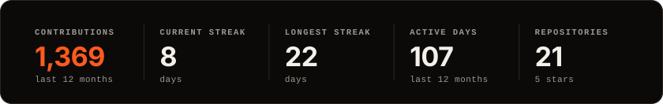

<div align="center">

<a href="https://khubaib-nazeer-protfolio.vercel.app/">
  
</a>

<br/><br/>

<a href="https://khubaib-nazeer-protfolio.vercel.app/"></a>
<a href="https://www.linkedin.com/in/khubaib-nazeer-039b47384/"></a>
<a href="mailto:khubaibnazeer8@gmail.com"></a>

</div>

## About

I'm a BS Computer Science student at FAST NUCES Lahore who learns by building, breaking, and debugging things until they make sense. I ship projects as usable products, on strong fundamentals: data structures, algorithms, OOP, and clean architecture.

- **Full-stack:** React, Node.js, Express, PostgreSQL and MongoDB, from schema to UI
- **AI / ML:** computer vision with PyTorch and YOLOv8, served through FastAPI
- **Systems:** C, C++ and x86 Assembly, plus developer tooling in Rust
- **Open to:** internships, open-source collaboration, and freelance builds

## Toolkit

<table align="center">
<tr><td align="right"><sub><b>LANGUAGES</b></sub></td><td>


</td></tr>
<tr><td align="right"><sub><b>FRONTEND</b></sub></td><td>

</td></tr>
<tr><td align="right"><sub><b>BACKEND & DATA</b></sub></td><td>


</td></tr>
<tr><td align="right"><sub><b>TOOLS</b></sub></td><td>

</td></tr>
<tr><td align="right"><sub><b>AI AGENTS</b></sub></td><td>


</td></tr>
</table>

## Featured projects

| Project | What it is | Stack | Links |
|:--|:--|:--|:--|
| **GitAtlas** | Turns any GitHub repo into a 3D world: city mode, force-directed graphs, and a commit-history constellation | React · Three.js · TypeScript | [Live](https://git-atlas-nu.vercel.app) · [Code](https://github.com/Khubaib7-del/GitAtlas) |
| **Thruline** | Companion layer for AI coding agents: decision logs, review queue, context health, cross-agent memory over MCP | Rust · TypeScript · MCP | [Docs](https://thruline-steel.vercel.app) · [Code](https://github.com/Khubaib7-del/thruline) |
| **CogniVision** | Live student attention and cheating-behaviour detection, EfficientNet-B2 + YOLOv8, **90.1% val. accuracy** | Python · PyTorch · YOLOv8 · FastAPI | [Code](https://github.com/Khubaib7-del/Cognivision) |
| **Bite Balance** | Full-stack meal planning and nutrition tracking with JWT auth and a PostgreSQL API | React · Node · PostgreSQL | [Code](https://github.com/Khubaib7-del/Bite-Balance) |
| **AlgoViz** | Search (DFS, BFS, A\*, UCS, IDS) and game-theory (Minimax, Alpha-Beta) visualizer on an interactive grid | HTML · CSS · JS | [Live](https://khubaib7-del.github.io/ALGORITHM-VISUALIZER/) · [Code](https://github.com/Khubaib7-del/ALGORITHM-VISUALIZER) |
| **OS Scheduler Visualizer** | FCFS, SJF, SRTF and Round Robin with live Gantt charts and per-process stats | HTML · CSS · JS · SVG | [Live](https://khubaib7-del.github.io/OS-Scheduler-Visualizer/) · [Code](https://github.com/Khubaib7-del/OS-Scheduler-Visualizer) |
| **Echo Drift** | WebGL puzzle platformer where your recorded past becomes the hazard | React · TypeScript · PixiJS | [Play](https://echo-drift.vercel.app) · [Code](https://github.com/Khubaib7-del/Echo-Drift) |
| **Goblin Grit** | Pixel-art platformer with jumping and slash combat | Browser game | [Play](https://goblin-grit.vercel.app) · [Code](https://github.com/Khubaib7-del/Goblin-Grit) |
| **POP Rush** | Balloon-popping arcade game written entirely in x86 Assembly, with a 3-level Time Attack mode | x86 Assembly | [Code](https://github.com/Khubaib7-del/POP-RUSH) |

## GitHub at a glance

<div align="center">

<p></p>
<p></p>
<p></p>

<sub>Drawn by this repo's own workflow and refreshed daily, so nothing here depends on an outside stats service.</sub>

</div>

## Now

```yaml
building:  developer tools and AI-agent workflows (Rust, MCP), full-stack apps
learning:  OS, systems programming, deeper DSA, applied ML
principle: "Never claim a skill until it's genuinely learned."
```

<div align="center">
<br/>
<sub><i>Build it, break it, debug it — until it makes sense.</i></sub>
</div>
