&nbsp;
&nbsp;
&nbsp;

### About

I build software end to end, and I build it with AI agents as part of the team. Right now that's **Tern**, a desktop app for deep research and study written in Rust, and **Selvard**, a privacy-first Android security shield where every check runs on the device.

Before those came **Thruline**, a shared memory layer for AI coding agents, **CogniVision**, a computer-vision system for classroom attention, and **GitAtlas**, which turns any repo into a 3D world. I like going underneath too, so there's C, C++ and x86 Assembly in here as well.

- **I make:** web apps, desktop apps and Android apps, plus tooling for AI coding agents
- **I care about:** local-first, privacy-respecting software that's honest about its limits
- **I'm learning:** AI engineering in depth, from RAG and agents to evals
- **Open to:** internships, collaboration, and freelance websites and apps

### Toolkit

### Featured projects

### GitHub at a glance

<a href="https://khubaib7-del.github.io/Khubaib7-del/">Open the interactive version</a> to hover any week and see the repos and pull requests behind it.

### Now

